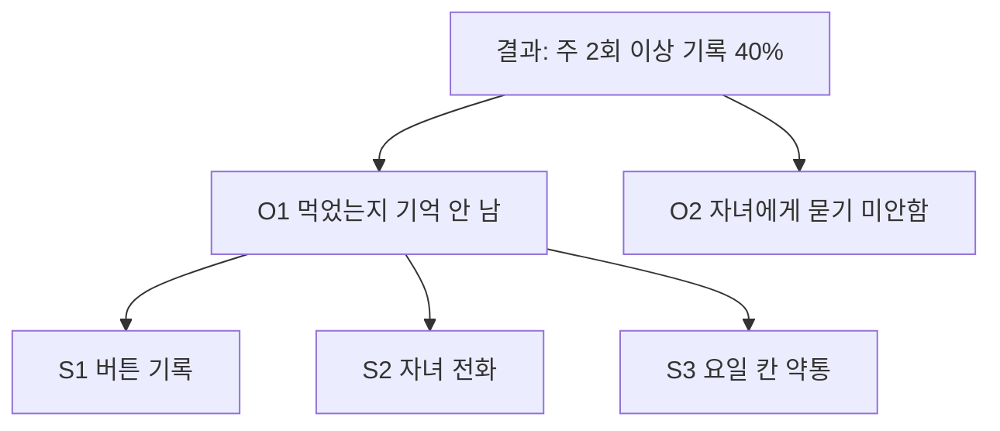

# 기회 지도, 가정 지도, 실험 카드

언제 여는 파일인가: 절차 5단계(기회 해결책 나무), 6단계(가정 지도), 7단계(실험 카드), 8단계(넘기기 초안).

## 1. 기회 해결책 나무 (Opportunity Solution Tree)

구조는 위에서 아래로 네 층이다.

1. **결과(outcome)**: 맨 위에 하나. 고객 행동이나 감정으로 잰다(예: "가입 2주 안에 주 2회 이상 복용 기록한 사용자 비율"). 매출 같은 사업 지표보다 제품 결과를 고른다.
2. **기회(opportunity)**: 고객의 필요, 불편, 바람. 인터뷰에서 들은 말로 쓴다.
3. **해결책(solution)**: 대상 기회 하나에 대한 후보. 3개 이상.
4. **가정 시험(assumption test)**: 해결책마다 가장 위험한 가정을 겨누는 작은 시험.

규칙:

- 기회 문장에 해결책이 숨어 있으면 안 된다. 시험: 그 기회를 푸는 서로 다른 해결책을 2개 이상 떠올릴 수 있는가. "알림 앱이 필요하다"는 해결책이고, "저녁 약을 먹었는지 기억이 안 난다"는 기회다.
- 기회마다 근거 인터뷰 ID를 단다. 근거 없는 기회는 `[가정]`이다.
- 큰 기회는 하위 기회로 쪼갠다. 대상 기회는 한 번에 하나만 고른다.
- 인터뷰 3~4건마다 기회를 다시 묶고 대상 기회를 다시 고른다.

문서 5절 표기 (bar 기계 검사 4, 5번이 이 형식을 센다):

```markdown
- 결과: 가입 2주 안에 주 2회 이상 복용 기록한 사용자 비율 40%
- O1. 저녁 약을 먹었는지 기억이 안 난다 (근거: I-01, I-03) [이야기]
- O2. 자녀에게 매번 묻기 미안하다 (근거: I-01) [이야기]
- 대상 기회: O1
- S1. 약을 먹으면 약통 옆 버튼을 눌러 기록
- S2. 저녁 9시에 자녀가 전화로 확인
- S3. 요일별 칸 약통(이미 파는 물건) 사용법 안내
```



## 2. Job 문장 (Jobs to Be Done)

job은 특정 상황에서 사람이 이루려는 진전이다. 기능, 사회, 감정 차원을 함께 본다. 기회를 묶을 때 아래 꼴로 한 줄씩 쓴다.

- "[상황]일 때, [하려는 일]을 하고 싶다, 그래서 [기대 결과]."
- 예: "저녁 약을 먹고 잠들 때, 먹었는지 확실히 알고 싶다, 그래서 걱정 없이 잔다(감정)."

설문으로 수를 모을 수 있으면 Strategyn 기회 공식을 쓴다: `importance + max(0, importance - satisfaction)`. 중요하지만 덜 만족된 필요가 높은 점수를 받는다. 표본 수와 질문 문장을 함께 적는다.

## 3. 가정 지도

해결책마다 "이것이 통하려면 무엇이 참이어야 하나"를 적는다. 가정은 "우리는 ~라고 믿는다"로 시작하고, 시험할 수 있게 구체적으로 하나씩 쓴다.

네 위험으로 나눈다.

| 위험 | 묻는 것 | 예 |
|---|---|---|
| 가치 | 고객이 사거나 쓰기로 할까 | 우리는 70대가 매일 버튼을 누를 만큼 확인을 원한다고 믿는다 |
| 사용성 | 쓰는 법을 알아낼까 | 우리는 설명서 없이 첫날 버튼 기록을 해낸다고 믿는다 |
| 실현 가능성 | 가진 시간, 기술, 사람으로 만들 수 있나 | 우리는 2주 안에 버튼과 앱 연결을 만들 수 있다고 믿는다 |
| 사업 타당성 | 비용, 법, 유통, 지원이 성립하나 | 우리는 자녀가 월 3,000원을 낼 것이라고 믿는다 |

배치: 세로축은 중요도(틀리면 아이디어가 무너지는가), 가로축은 증거(관찰한 근거가 있는가). "중요하고 증거 없음" 칸부터 실험한다.

문서 6절 표기:

| ID | 해결책 | 위험 | 가정 | 중요도 | 증거 | 칸 |
|---|---|---|---|---|---|---|
| A1 | S1 | 가치 | 우리는 ... 믿는다 | 높음 | 없음 | 먼저 시험 |

## 4. 실험 카드

위험이 가장 큰 가정 1~3개에 하나씩 쓴다. 합격선은 실험 전에 숫자로 적는다.

```markdown
#### E1 (가정 A1, 작성 2026-10-20)

- 가설: 우리는 70대 사용자가 매일 저녁 기록 버튼을 누를 것이라고 믿는다
- 실험: 종이 체크 카드를 5명에게 1주일 드리고 사진으로 받는다(컨시어지)
- 측정: 7일 중 체크한 날 수
- 합격선: 5명 중 3명 이상이 7일 중 5일 이상 체크
- 기한: 2026-10-27
- 비용: 인쇄비 1만 원, 오너 시간 2시간
- 결정 규칙: 합격이면 S1 진행, 불합격이면 S2 실험
- 결과: (실험 뒤 기록. 합격 여부와 원자료 위치)
```

싼 것부터 고른다(흔한 순서):

1. 이미 있는 기록 보기(문의, 리뷰, 로그)
2. 인터뷰 몇 건 더
3. 사람이 손으로 서비스해 보기(컨시어지)
4. 종이나 클릭 프로토타입으로 사용성 시험
5. 없는 기능의 버튼이나 안내 페이지로 관심 재기(가짜 문)
6. 선주문, 보증금

가짜 문 실험은 누른 사람에게 곧바로 사실을 알리고 사과 문구를 보여 준다. 속인 채 끝내지 않는다.

## 5. 넘기기 초안 (8절)

진행으로 결정하면 `gotechy-spec`이 받을 재료를 적는다(Shape Up 피치 재료).

- **문제**: 현재 방식이 왜 안 되는지 보여 주는 구체적 이야기 하나(인터뷰 인용 링크).
- **appetite**: 쓸 시간의 예산. 추정이 아니다. 예: "2주". 이 시간 안에 끝나도록 해결책을 깎는다.
- **rabbit hole**: 시간을 크게 잡아먹을 수 있는 미지수. 해소 방법(단순화, 범위 밖 선언, 잘라 내기)을 함께 적는다. 기술 담당에게 "이 기간 안에 되나"를 물은 답을 남긴다.
- **no-gos**: 이번에 일부러 하지 않는 기능과 사용 사례.
