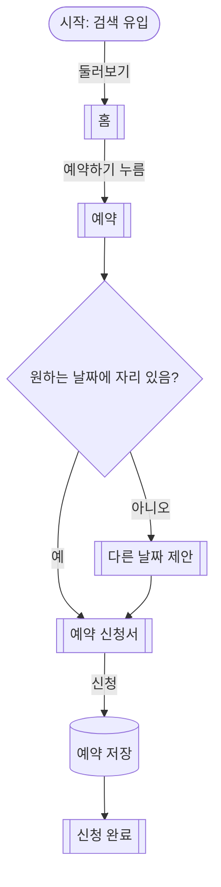

# [프로젝트명] 유저 플로우 (30-user-flow)

<!-- 언제 여는 파일인가: 위저드 4/7. 하드 게이트: 20-features에 확정된 기능이 1개 이상 있어야 시작한다.
     기능을 화면으로 옮기는 다리다. 여기의 페이지 노드 목록이 40-sitemap(gotechy-design)의 원천이 된다.
     노드 표기: 시작([이름]), 페이지[[이름]], 데이터[(이름)], 분기{질문?}, 행동은 연결선 이름.
     범위 선택지: 핵심 여정만(기본) | 예외 흐름 포함 | 역할별 분리 | 넘겨주기용 상세. -->

- 상태: 초안
- 선행: 20-features.md 확정 기능 (F1-1, ...)
- 범위: 핵심 여정만
- 작성: YYYY-MM-DD

## 핵심 여정: [여정 이름, 예: 첫 방문에서 첫 예약 신청까지]

## 예외 흐름

<!-- 핵심 여정 그림을 어지럽히지 않게 따로 쓴다. 20-features의 IF THEN 수용 기준마다 하나씩. -->

### 예외: [이름] (AC-?-?.?)

## 페이지 노드 목록 (40-sitemap의 입력)

| 페이지 | 등장 여정 | 핵심 역할 | 연결 기능 ID |
|---|---|---|---|
| 홈 | 핵심 | 가치 전달과 예약 버튼 | F1-1 |

<!-- 모든 노드는 기능 ID에 연결되어야 한다. 연결할 기능이 없으면 20-features에 [SYNC NEEDED: ...]를 넣거나 노드를 지운다. -->

## Q&A 로그

## 확정 이력
