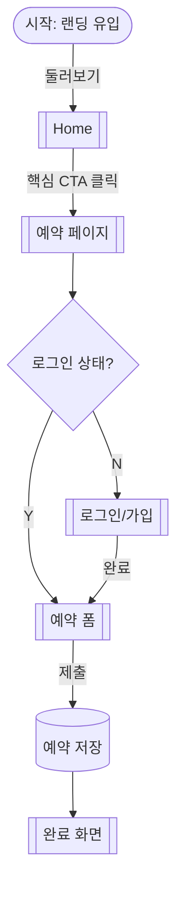

# [프로젝트명] — 유저플로우 (30-user-flow)

- 상태: 초안 · 선행: 20-features.md에 기능 1개 이상 확정 (하드 게이트)
- 작성: YYYY-MM-DD

<!-- 위저드 4/7. 기능을 화면으로 변환하는 다리 — 여기의 페이지 노드 목록이 40-sitemap의 원천이다.
     매니페스트 노드 5종 컨벤션: 시작([*]) / 페이지([[이름]]) / 데이터[(이름)] / 분기{질문?} / 행동(엣지 라벨).
     범위 선택지: 핵심 여정만 | 예외 흐름 포함 | 역할별 분리 | 핸드오프용 상세 — 기본은 "핵심 여정만". -->

## 핵심 여정: [여정 이름 — 예: 방문 → 첫 예약 완료]

<!-- 예외 흐름은 별도 소절로 (핵심 여정 다이어그램을 오염시키지 않는다):
## 예외: 결제 실패 / 세션 만료 … -->

## 페이지 노드 목록 (→ 40-sitemap의 입력)

| 페이지 | 등장 여정 | 핵심 역할 |
|---|---|---|
| Home | 핵심 | 가치 전달 + CTA |

## Q&A 로그

## 확정 이력
